<div align="center">


# 📖 TEC.OpenApi

**Documentação OpenAPI nativa e interface interativa Scalar no padrão corporativo Tudo em Código: metadados, esquemas JWT Bearer e temas customizados.**

Scalar · OpenAPI Nativo (.NET 10 / ASP.NET Core) · JWT Bearer RFC 6750 · OpenID Connect · .NET 10 · Native AOT

[](https://github.com/tudoemcodigo/lib-tec-openapi/actions/workflows/ci.yml)
[](#-compatibilidade)
[](#-compatibilidade)
[](CHANGELOG.md)
[](LICENSE)

[📥 Instalação](#-instalação) · [🚀 Início rápido](#-início-rápido) · [📝 Changelog](CHANGELOG.md) · [📄 Licença](LICENSE)

</div>

---

## 📑 Sumário

- [✨ Por que usar](#-por-que-usar)
- [📦 Pacotes](#-pacotes)
- [📥 Instalação](#-instalação)
- [🚀 Início rápido](#-início-rápido)
- [🔒 Proteção da documentação](#-proteção-da-documentação)
- [⚙️ Configuração avançada](#️-configuração-avançada)
- [🧩 Diagrama de arquitetura](#-diagrama-de-arquitetura)
- [⚡ Compatibilidade](#-compatibilidade)
- [📄 Licença](#-licença)

---

## ✨ Por que usar

| Sem o TEC.OpenApi | Com o TEC.OpenApi |
|---|---|
| Configuração manual e verbosa de OpenAPI e Swagger em cada microsserviço | Linha única `AddTecOpenApi()` e `MapTecApiDocs()` |
| Swagger UI pesado, lento e visualmente defasado | **Scalar**: interface interativa ultrarrápida, moderna e responsiva |
| Falta de padronização nos metadados, termos, licença e segurança de cada API | Injeção centralizada de informações corporativas, termos e licenças |
| Configuração repetitiva do esquema de segurança JWT Bearer e OpenID Connect | Configuração automática de `Bearer` e botões de autenticação no Scalar |
| Incompatibilidade com Native AOT por dependências de reflexão em tempo de execução | Código do pacote compatível com Native AOT e trimming (analisadores de AOT como erro no build) |

---

## 📦 Pacotes

| Pacote | O que contém | Onde usar |
|---|---|---|
| `TEC.OpenApi` | Extensões para DI e mapeamento de rotas OpenAPI e Scalar, transformers corporativos de documento e operações | Em APIs ASP.NET Core (`Program.cs`) |

---

## 📥 Instalação

O pacote sai no feed do GitHub Packages da organização (o GitHub exige token mesmo para pacote público):

```bash
dotnet nuget add source https://nuget.pkg.github.com/tudoemcodigo/index.json -n tec-interno -u <usuario> -p <PAT>
```

### Central Package Management (`Directory.Packages.props`)

```xml
<ItemGroup>
  <PackageVersion Include="TEC.OpenApi" Version="0.0.1" />
</ItemGroup>
```

No projeto Web API (`*.csproj`):

```xml
<ItemGroup>
  <PackageReference Include="TEC.OpenApi" />
</ItemGroup>
```

---

## 🚀 Início rápido

No seu `Program.cs`:

```csharp
using TEC.OpenApi;

var builder = WebApplication.CreateBuilder(args);

// Registra OpenAPI e Scalar com os padrões da Tudo em Código
builder.Services.AddTecOpenApi(options =>
{
    options.Title = "Template Vendas API";
    options.Description = "API de gerenciamento de clientes, pedidos e itens.";
});

var app = builder.Build();

// Mapeia /openapi/v1.json e a interface interativa em /docs (por padrão, só em Development)
app.MapTecApiDocs();

app.Run();
```

Abra seu navegador em `/docs` (ou `/docs/v1`) para interagir com a interface Scalar da sua API.

---

## 🔒 Proteção da documentação

O documento expõe rotas, parâmetros e esquemas da API. Por isso o pacote fecha por padrão:

- **Guarda de ambiente**: fora de Development (Production, Staging ou qualquer outro nome), `MapTecApiDocs()`,
  `MapTecOpenApi()` e `MapTecScalar()` **não mapeiam nada** e registram um aviso (EventId 5001). As rotas respondem 404.
  Para expor, ligue `ExposeOutsideDevelopment` (decisão explícita) e, de preferência, exija autorização.
- **Autorização pelas opções**: `RequireDocumentationAuthorization = true` aplica a política padrão (usuário autenticado)
  ao documento e à interface; `DocumentationAuthorizationPolicy = "nome"` aplica uma política registrada em
  `AddAuthorization`. Vale em qualquer ambiente. A aplicação precisa de `UseAuthentication()` e `UseAuthorization()`.
- **Autorização pelo retorno**: os três métodos devolvem `IEndpointConventionBuilder`, então dá para encadear
  convenções. No `MapTecApiDocs()`, a convenção vale para o documento e para a interface.

```csharp
builder.Services.AddTecOpenApi(options =>
{
    options.ExposeOutsideDevelopment = true;
    options.DocumentationAuthorizationPolicy = "documentacao";
});

// ou, sem as opções de autorização:
app.MapTecApiDocs().RequireAuthorization("documentacao");
```

> [!NOTE]
> A página do Scalar é aberta pelo navegador, que não envia token Bearer sozinho. Proteger a interface com JWT só funciona
> se o navegador tiver outra credencial (cookie da aplicação, autenticação no gateway). Os arquivos estáticos do Scalar
> (`scalar.js`) continuam públicos: são o código da biblioteca, sem dados da sua API.

---

## ⚙️ Configuração avançada

```csharp
using Scalar.AspNetCore;

builder.Services.AddTecOpenApi(options =>
{
    options.Title = "E-Commerce Gateway";
    options.Version = "v1";
    options.Description = "Serviços de vendas e checkout Tudo em Código";
    options.ScalarRoutePrefix = "documentacao";
    options.ScalarTheme = ScalarTheme.Moon;
    options.EnableJwtBearer = true;
    options.JwtBearerDescription = "Informe o token JWT obtido no Keycloak corporativo";
    options.OpenIdConnectUrl = "https://auth.minhaempresa.com.br/realms/corporativo/.well-known/openid-configuration";
});
```

Opções de `TecOpenApiOptions` (valores padrão do código):

| Opção | Padrão | Efeito |
|---|---|---|
| `Title` · `Version` · `Description` | `"API Tudo em Código"` · `"v1"` · texto genérico | Metadados do documento. Troque os três: o padrão aparece na documentação da sua API |
| `DocumentName` | `"v1"` | Nome do documento no ASP.NET Core (`/openapi/{nome}.json`). O `MapTecScalar()` registra o mesmo nome no Scalar; não repita `AddDocument` com ele no `configureScalar`. Vazio derruba a subida |
| `EnableJwtBearer` | `true` | Registra o esquema `Bearer` e o liga às operações com `[Authorize]` (401 e 403 documentados) |
| `JwtBearerSchemeName` · `JwtBearerDescription` | `"Bearer"` · texto padrão | Nome e descrição do esquema |
| `OpenIdConnectUrl` | `null` | Registra o esquema `OpenID` (só com `EnableJwtBearer`). Precisa ser URL absoluta HTTPS, sem usuário e senha: valor inválido derruba a subida em `AddTecOpenApi()` |
| `ContactName` · `ContactEmail` | `null` · `null` | Contato do documento. Só entra se você definir |
| `LicenseName` · `LicenseUrl` | `null` · `null` | Licença do documento. Só entra com `LicenseName` definido |
| `ScalarRoutePrefix` · `ScalarTitle` · `ScalarTheme` | `"docs"` · `"Referência da API \| Tudo em Código"` · `Mars` | Rota, título e tema do Scalar |
| `RequireAuthorizationByDefault` | `false` | Só **documenta** (e só com `EnableJwtBearer`): marca todas as operações sem `[AllowAnonymous]` como autenticadas no documento. Não aplica autorização nenhuma; use `RequireAuthorization()` nas rotas |
| `ExposeOutsideDevelopment` | `false` | Mapeia o documento e a interface fora de Development (ver [Proteção da documentação](#-proteção-da-documentação)) |
| `RequireDocumentationAuthorization` | `false` | Exige a política padrão de autorização no documento e na interface |
| `DocumentationAuthorizationPolicy` | `null` | Exige a política nomeada no documento e na interface. Só espaços derruba a subida |

---

## 🧩 Diagrama de arquitetura

Componentes e ligações do `TEC.OpenApi`, gerados pelo [GitDiagram](https://gitdiagram.com/tudoemcodigo/lib-tec-openapi) a partir da `main` em 02/11/2026. O diagrama é gerado por IA a partir de uma amostra do código: use-o como mapa de leitura, não como contrato.

```mermaid
flowchart TD

subgraph group_setup["Configuration and registration"]
  node_options["Documentation options"]
  node_extensions["Registration and mapping"]
end

subgraph group_document["OpenAPI document"]
  node_openapi["ASP.NET Core OpenAPI"]
  node_doc_transformer["Metadata and schemes"]
  node_operation_transformer["Operation security"]
end

subgraph group_endpoints["Documentation endpoints"]
  node_json_endpoint["OpenAPI JSON endpoint"]
  node_scalar_endpoint["Scalar UI endpoint"]
  node_conventions["Convention forwarding"]
  node_environment["Environment and authorization"]
  node_logging["Mapping warning<br/>[TecOpenApiLog.cs]"]
end

node_app(("ASP.NET Core app"))
node_scalar["Scalar.AspNetCore"]

node_app -->|"configures and maps"| node_extensions
node_extensions -->|"configures"| node_options
node_extensions -->|"registers document"| node_openapi
node_extensions -->|"registers transformer"| node_doc_transformer
node_extensions -->|"registers transformer"| node_operation_transformer
node_doc_transformer -->|"reads settings"| node_options
node_operation_transformer -->|"reads settings"| node_options
node_extensions -->|"maps document"| node_json_endpoint
node_extensions -->|"maps interface"| node_scalar_endpoint
node_extensions -->|"configures UI"| node_scalar
node_extensions -->|"checks mapping access"| node_environment
node_environment -->|"logs blocked mapping"| node_logging
node_extensions -->|"combines endpoint builders"| node_conventions
node_conventions -->|"forwards conventions"| node_json_endpoint
node_conventions -->|"forwards conventions"| node_scalar_endpoint
node_extensions -->|"applies authorization settings"| node_options


classDef toneNeutral fill:#f8fafc,stroke:#334155,stroke-width:1.5px,color:#0f172a
classDef toneBlue fill:#dbeafe,stroke:#2563eb,stroke-width:1.5px,color:#172554
classDef toneAmber fill:#fef3c7,stroke:#d97706,stroke-width:1.5px,color:#78350f
classDef toneMint fill:#dcfce7,stroke:#16a34a,stroke-width:1.5px,color:#14532d
classDef toneRose fill:#ffe4e6,stroke:#e11d48,stroke-width:1.5px,color:#881337
classDef toneIndigo fill:#e0e7ff,stroke:#4f46e5,stroke-width:1.5px,color:#312e81
classDef toneTeal fill:#ccfbf1,stroke:#0f766e,stroke-width:1.5px,color:#134e4a
class node_options,node_extensions toneBlue
class node_openapi,node_doc_transformer,node_operation_transformer toneAmber
class node_json_endpoint,node_scalar_endpoint,node_conventions,node_environment,node_logging toneMint
class node_app,node_scalar toneIndigo
```



## ⚡ Compatibilidade

- **Runtime:** .NET 10.0 (LTS), com o OpenAPI nativo do ASP.NET Core (`Microsoft.AspNetCore.OpenApi`).
- **Trimming / Native AOT:** o código do pacote compila com os analisadores de AOT como erro. O repositório não publica um app AOT de teste, então a compatibilidade das dependências (`Microsoft.AspNetCore.OpenApi` e `Scalar.AspNetCore`) não é verificada aqui.
- **Ambientes:** Windows, Linux e macOS (x64 e ARM64).

---

## 📄 Licença

Distribuído sob a licença [Apache 2.0](LICENSE).
